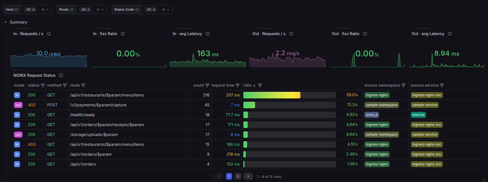

# nginx-prometheus-module

[](https://github.com/hatam-abolghasemi/nginx-prometheus-module/actions/workflows/nginx-tests.yml)
[](https://github.com/hatam-abolghasemi/nginx-prometheus-module/actions/workflows/openresty-tests.yml)
[](docs/images.md)
[](docs/images.md)
[](https://github.com/hatam-abolghasemi/nginx-prometheus-module/releases)
[](LICENSE)
[](https://github.com/hatam-abolghasemi/nginx-prometheus-module/stargazers)

**The metrics you'd expect nginx to expose on `/metrics` — now it does.**
Requests by method, sanitized route, status and host; latency, sizes,
upstream timing and connections; who called and who was called. Recorded by
nginx itself, no exporter process, no access logs to ship.

One module, two implementations that record the same metrics:

- **[The C module](docs/nginx/README.md)** for stock nginx, where development
  is focused. One line is the whole setup:

  ```nginx
  load_module modules/ngx_http_prometheus_module.so;
  ```

  Every request is recorded and served on `:9145/metrics`, whatever the rest
  of your configuration is.
- **[The Lua module](docs/openresty/README.md)** for OpenResty, maintained in
  parallel. It also decrypts outbound HTTPS and gRPC and records L4 streams,
  which the C module doesn't do yet.

```
nginx_http_requests_total{method="GET",route="/orders/$param",status="200",host="api.example.com",mode="0",source_service="checkout",source_namespace="shop",protocol="https"} 1027
```

IDs, UUIDs and hashes collapse to `$param`, so an order id is not a time
series. On Kubernetes both run as a sidecar in front of your app with one
variable, `APP_PORT`, and tell you who called it and what it calls.



<sub>The bundled [Grafana dashboard](grafana/) on a real workload: inbound (`in`)
and outbound (`out`) side by side, IDs collapsed to `$param`, and the caller's
namespace and service on every row.</sub>

## The C module

```bash
docker run -p 80:80 -p 9145:9145 ghcr.io/hatam-abolghasemi/nginx-prometheus-module/nginx:alpine
curl -s localhost:9145/metrics
```

The image is every official `nginx` tag, rebuilt with the module loaded. On
your own nginx: a prebuilt `.so` from the
[releases](https://github.com/hatam-abolghasemi/nginx-prometheus-module/releases),
or built from source in a second ([install](docs/nginx/README.md#install)).

| Guide | What it gives you |
|---|---|
| [The module](docs/nginx/README.md) | Install, configure, every directive, metric and label |
| [sidecar](docs/nginx/sidecar.md) | The image in front of your app, `APP_PORT` |
| [caller identity](docs/nginx/identity.md) | `source_service` / `source_namespace`, `app` / `namespace`, `client_subnet` |
| [outbound](docs/nginx/outbound.md) | The calls your app makes, through `127.0.0.1:3128` |

## The Lua module

Built on [OpenResty](https://openresty.org/) (nginx + Lua), shipped as the
OpenResty image and run as a sidecar beside your app.

### Try it in a minute

No Kubernetes needed. This brings up a demo app with the sidecar, generated traffic, Prometheus, and Grafana with the dashboard loaded:

```bash
git clone https://github.com/hatam-abolghasemi/nginx-prometheus-module.git
cd nginx-prometheus-module/examples/quickstart
docker compose up -d
```

Open <http://localhost:3000> for the dashboard, or look at the raw series:

```bash
curl -s localhost:9145/metrics | grep '^nginx_http_requests_total' | head -20
```

Watch `/anything/orders/1`, `/anything/orders/2`, … arrive as a single
`route="/anything/orders/$param"` with the real `status` kept. More in the
[quickstart guide](examples/quickstart/).

### What you get

A Prometheus `/metrics` endpoint with low-cardinality, well-labelled series —
`method`, sanitized `route` (IDs/UUIDs/hashes collapsed to `$param` so you don't
get a time series per order id), `status`, `host`, `mode` (`0` inbound / `1`
outbound), and `source_service` / `source_namespace` — across inbound,
outbound (including decrypted HTTPS via https interception), and stream (L4). The usual alternative is
shipping access logs somewhere and deriving metrics from them (more storage,
more I/O, more delay, rarely cardinality-safe) or reaching for Istio/OpenTelemetry
to get one slice of this. This gives you the whole picture from the proxy itself.

Full catalog in the [metrics reference](docs/openresty/metrics-reference.md).

### Features

Turn on only what you need. Click through for the step-by-step guide.

| Feature | What it gives you | Turn on with | Depends on |
|---|---|---|---|
| [**inbound**](docs/openresty/inbound.md) | Request metrics for traffic into your app | run the image | — |
| [**outbound**](docs/openresty/outbound.md) | Egress metrics (HTTPS as `CONNECT host:port`) | `HTTP(S)_PROXY=127.0.0.1:3128` on the app | — |
| [**https interception**](docs/openresty/https-interception.md) | Real route/status inside outbound HTTPS (any port) and gRPC (TLS or plaintext) | `INTERCEPT_TLS=on` + a CA | outbound |
| [**stream**](docs/openresty/stream.md) | TCP/UDP (Redis, DB…) from the app's side | a `stream.conf` | — |

```
ghcr.io/hatam-abolghasemi/nginx-prometheus-module/openresty:<openresty-tag>-<flavor>
```

**Already run OpenResty, or nginx with `lua-nginx-module`?** You don't need the
image — drop the Lua modules into your existing server: [running on your own
nginx](docs/openresty/standalone-nginx.md).

### Quick start

Run it as a sidecar beside your app (K8s) or in front of it (any OpenResty), set
`APP_PORT` to your app's port, and scrape `:9145/metrics` (plus `:9254/metrics`
once stream is on). A complete Kubernetes example — the app + sidecar
Deployment with inbound, outbound and stream on, a Service/ServiceMonitor, and
a kustomization — is in [`examples/openresty-sidecar/`](examples/openresty-sidecar/).
The [docs index](docs/openresty/README.md) walks each feature from there.

Then import the [Grafana dashboard](grafana/): inbound, outbound, connections
and L4 streams, one tab each.

## Documentation

- **[Documentation index](docs/README.md)**: both modules side by side, every guide
- **[Images](docs/images.md)**: both images, their tags, pinning
- **[Grafana dashboard](grafana/)**: ready to import; built on the Lua module's labels (its filters need `namespace` on the connection metrics, which the C module doesn't add yet)
- **[FAQ](docs/openresty/faq.md)**: why not Istio, OpenTelemetry or eBPF, limits, costs
- **[Changelog](CHANGELOG.md)** · **[Contributing](CONTRIBUTING.md)**: questions go to [Discussions](https://github.com/hatam-abolghasemi/nginx-prometheus-module/discussions), security reports to [SECURITY.md](SECURITY.md)

## Repository

| Path | |
|---|---|
| [`nginx/`](nginx/) | The C module: `config`, `src/`, its image (`docker/`), `tests/` |
| [`openresty/`](openresty/) | The Lua module: `lib/`, `vendor/`, its image (`docker/`), `tests/` |
| [`docs/`](docs/) | `nginx/`, `openresty/`, and what both share |
| [`examples/`](examples/) | `nginx-sidecar/`, `openresty-sidecar/`, the Docker `quickstart/` |
| [`grafana/`](grafana/) | The dashboard |

## Images & versioning

Both images are rebuilt from their upstream in **every flavor it publishes**,
on the same platforms, smoke-tested, and pushed to GHCR under **upstream's own
tags**: swap the image name, keep the tag.

```
ghcr.io/hatam-abolghasemi/nginx-prometheus-module/nginx:<nginx-tag>
ghcr.io/hatam-abolghasemi/nginx-prometheus-module/openresty:<openresty-tag>-<flavor>
```

The tag schemes, and how to pin by digest: [docs/images.md](docs/images.md).

GitHub **Releases** (`vX.Y.Z`) are separate: they mark this project's own
milestones, carry the prebuilt module `.so` files, and their notes are their
section of the [changelog](CHANGELOG.md), including what to check when
upgrading. The image tag answers "which nginx am I on?"; the release answers
"which version of this project is it?".

## Built on

The C module is plain C against nginx's own API. In the Lua module, the
Prometheus client internals (counter/gauge/histogram storage and the
exposition-format serializer) are vendored **unmodified** from
[knyar/nginx-lua-prometheus](https://github.com/knyar/nginx-lua-prometheus)
(MIT, © Anton Tolchanov), under
[`openresty/vendor/nginx-lua-prometheus/`](openresty/vendor/nginx-lua-prometheus/). This project adds
the observability layer — route sanitization, source attribution, the
inbound/outbound/stream proxies, and https interception — on top of that
library's public API. Full credit for the library is upstream's.

## License

This project is MIT licensed (see [`LICENSE`](LICENSE)). Vendored third-party
code under `openresty/vendor/` is kept under its own license
([`openresty/vendor/nginx-lua-prometheus/LICENSE`](openresty/vendor/nginx-lua-prometheus/LICENSE)).
